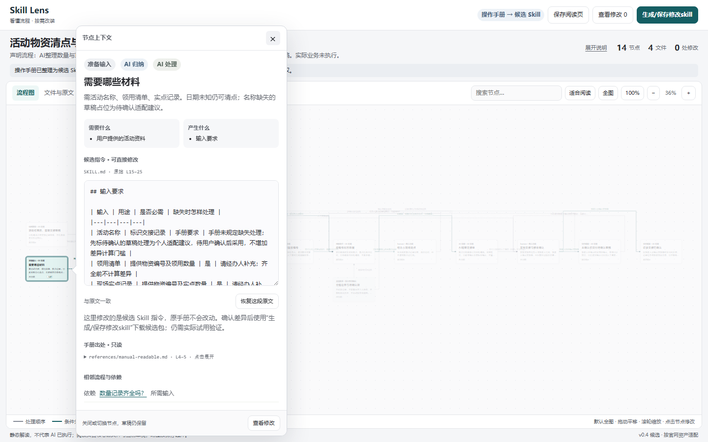

# Skill Lens

**Click a step in a workflow map, check the instruction behind it, and save a version that fits your work.**

[简体中文](README.zh-CN.md) · **[Try the offline HTML demo](https://github.com/Owen-Teng/skill-lens/releases/download/v0.7.1/skill-lens-demo.html)** · [Download the toolkit](https://github.com/Owen-Teng/skill-lens/releases/download/v0.7.1/skill-lens-v0.7.1-node.zip)

**Try it without an account.** Download the HTML and open it in a desktop browser. Hover over a step to see its direct relationships. Click a node, compare it with the source, edit a candidate instruction and save a new Skill. The Chinese sample uses a fictional event-inventory handoff. GitHub's file viewer does not run HTML; the downloaded reader works offline. It does not generate maps from new inputs on its own.

| Start with | What you can do |
|---|---|
| An existing Skill folder, archive or SKILL.md | Inspect the declared workflow, trace steps to their instructions, and change only the passages you want to adapt. |
| An operating manual or SOP | Have an agent draft a candidate Skill using a fixed template. Check responsibilities and uncertain steps against the read-only manual before saving. |

A new export leaves **Include Lens** off by default. Turn it on to share the current reader and first map without recursively nesting exports. After edits, the map needs a fresh interpretation. It describes expected behavior, not execution traces.

## Connect an agent platform

1. Extract the toolkit on a platform providing Node.js 24.x, isolated task storage, and artifact preview/download. Production uses Node built-ins only; no Python or npm packages.
2. Register the [JSON stdin tool](skill-lens/scripts/platform_tool.mjs) against the [tool schema](skill-lens/references/platform-tool-schema.json). Map returned task-relative artifacts to authorized links. See the [integration examples](skill-lens/references/platform-integration.md).
3. The **agent interprets** instructions and drafts steps. The **compiler verifies** source fingerprints, line and UTF-16 ranges, preserves unchanged attachments, and produces self-contained HTML. Once connected, employees use a browser.

**Status:** locally tested platform integration candidate by Owen Teng; no live company agent deployment or real HR outcome is claimed. Word/PDF extraction is supplied by the host; the compiler has no OCR or embedded model. Creators review the semantics of every candidate.

[Validation and scope](docs/verification.md) · [Release assets](https://github.com/Owen-Teng/skill-lens/releases/tag/v0.7.1)
