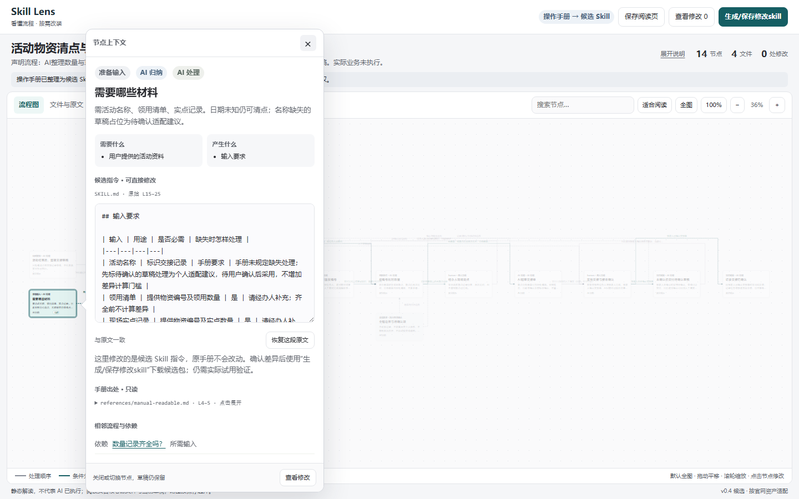

# Skill Lens

**点开流程图里的一个步骤，找到它对应的原文，改好后另存自己的 Skill。**

[English](README.md) · **[下载离线演示 HTML](https://github.com/Owen-Teng/skill-lens/releases/download/v0.7.1/skill-lens-demo.html)** · [下载平台工具包](https://github.com/Owen-Teng/skill-lens/releases/download/v0.7.1/skill-lens-v0.7.1-node.zip)

**先试一次，不用安装。** 下载上方 HTML，用桌面浏览器打开。示例是一份虚构的活动物资交接手册。悬停节点看直接关联，点开节点核对出处，修改候选指令，然后点「生成/保存修改skill」。GitHub 文件页只显示源码；下载后的 HTML 可离线交互。生成另一份材料的图需要平台接入。

| 手头的材料 | 怎么用 |
|---|---|
| 已有 Skill 文件夹、压缩包或 SKILL.md | 让 Agent 读懂指令与依赖，在图上逐步查证，只改需要适配自己的段落。 |
| 工作手册、SOP 或操作指引 | 让 Agent 根据固定模板起草候选 Skill。原手册只读，在图里核对人工责任、工具动作和待确认项，再保存自己的版本。 |

导出时可决定是否附带 Lens；新包默认不勾选。附带后保留当前阅读页和首次原图，多次传递不层层套入。改过指令后，旧图会提示需要重新解读。图描述材料规定或预计的流程，不是执行记录。

## 平台接入

1. 管理员解压工具包，在平台提供 Node.js 24.x、隔离的任务目录和附件存储。生产代码只用 Node 内置模块，不需要 npm 包或 Python。
2. 注册 [platform_tool.mjs](skill-lens/scripts/platform_tool.mjs)，按[工具参数](skill-lens/references/platform-tool-schema.json)通过标准输入提交 JSON；将返回的成果路径转换成用户有权访问的预览或下载链接。[完整接入示例](skill-lens/references/platform-integration.md)。
3. Agent 负责理解材料、编排候选步骤；固定编译器核对源版本、行号和 UTF-16 文本位置，保留未修改附件并生成 HTML。接入完成后，使用者在浏览器操作。

Owen Teng 的独立工具。启用问候只在工具对话中出现，不写入使用者的成果。**当前是平台接入候选，未部署到真实公司 Agent。** 编译器不含模型或 OCR，Word/PDF 转写依赖平台已有能力。合成示例不代表真实业务效果，候选内容仍由创作者核对。

[版本与验证范围](docs/verification.md) · [发布附件与校验值](https://github.com/Owen-Teng/skill-lens/releases/tag/v0.7.1)
